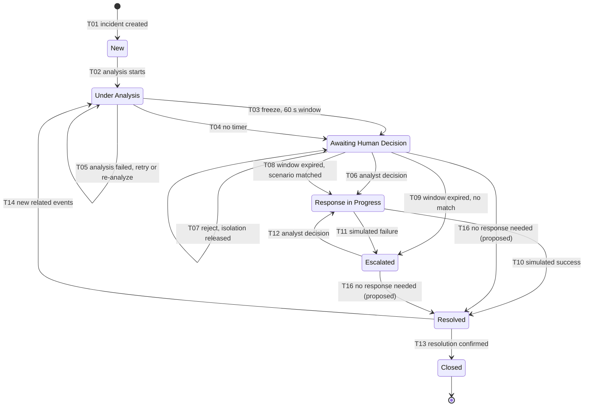

# Response workflow specification

| | |
|---|---|
| **Project** | ICD (Intelligent Cyber Defense) |
| **Owner** | C5, Incident Response & Security Assurance |
| **Task** | T1-13 (Week 1). Implemented in Week 2 by T2-13 (response engine v0) and T2-14 (simulated executor and catalogue) |
| **Status** | Draft. Items marked **(proposed, needs C1/C3/C4 agreement)** are C5 design choices, not decisions |
| **Sources** | Ratified decision register (19 Oct 2026); approved requirements FR-23 to FR-45, FR-31, NFR-SF-01, NFR-SF-06, NFR-SF-07, NFR-P-09; Week 1 task sheet |

## 1. Scope and safety rule

> **Every response action in ICD is a simulation.** No component touches a real host, IP address, user account or firewall. Every simulated action is labelled `SIMULATED` on every record and every screen, and is audited (C-13, NFR-SF-01, NFR-SF-07, AS-19, FR-45).

This document specifies the incident-response workflow: the incident lifecycle, the conditions for a response freeze, the 60-second decision window, the three analyst options, the simulated response catalogue, failure handling and the audit records the workflow writes.

It is documentation only. It does not change code, migrations, dependencies or the shared contracts in `contracts/`. Section 11 lists what the workflow needs from C3's contracts, for C3 to check against the frozen v1.

Each rule cites its source: FR (functional requirement), NFR (non-functional requirement), OD (open or ratified decision), TD (team decision), AS (acceptance scenario), C (constraint), R (risk).

**General rule for every transition (proposed, needs C1/C3/C4 agreement).** A transition, its side effects (window record, simulated isolation) and its audit records are written in one database transaction. If the transaction fails, nothing is committed, the incident keeps its previous state, and the error is recorded. Section 3 refers to this as **rule TX**.

## 2. Lifecycle states

An incident is always in exactly one of these seven states (FR-31, TD-11, OD-14).

| State | Meaning |
|---|---|
| `New` | Created by C3's correlation; analysis has not started. Replaces the former name "Detected" (TD-11, ratified). |
| `Under Analysis` | The analysis job is running, or the last analysis failed (see analysis status below). |
| `Awaiting Human Decision` | A valid analysis exists and the incident waits for an analyst. It may carry an open response window (a freeze), or no timer. |
| `Response in Progress` | A simulated scenario from the catalogue is being executed. |
| `Escalated` | No scenario could run, or a simulated action failed. The SOC Manager is notified; an analyst must decide. |
| `Resolved` | A simulated scenario finished successfully. |
| `Closed` | The resolution was confirmed. The incident stays readable (FR-31). |

Lifecycle rules (FR-31):
- An undefined transition is rejected, the state is unchanged, and the refusal is recorded (T15).
- Every status change is stored with the previous state, the new state, the time, the actor and the cause.
- A closed incident stays readable.
- New related events (FR-09) that arrive while the incident is in `Under Analysis`, `Awaiting Human Decision`, `Response in Progress` or `Escalated` are attached and trigger re-analysis, but do not change the state. An open window is neither ended nor extended (OD-17). Only from `Resolved` do new related events cause a transition (T14).

Design choices, all **(proposed, needs C1/C3/C4 agreement)**:

| Topic | Proposed rule | Source |
|---|---|---|
| Freeze | The freeze is **not a state**. It is a response window attached to an incident in `Awaiting Human Decision`, plus a simulated host isolation flag `isolated (simulated)`. | Spec Figure 4.6-4; OD-17 left it open |
| Analysis failure | Analysis failure is **not a state**. It is an analysis status `Analysis failed` on an incident that stays in `Under Analysis`, with one automatic retry and then a manual re-analyze button. It never starts a freeze. | OD-09 |
| Low risk | Low-risk incidents also go to `Awaiting Human Decision`, with no timer and no notification, so they are listed and an analyst can act on them. | OD-18 |
| Reopening | A closed incident cannot be reopened in the MVP. | OD-14 (open) |

## 3. Transitions table

"Actor" in each audit record is the user ID of the analyst, or `system`. Rule TX is defined in section 1.

| ID | From state | Triggering event | Required conditions | To state | Audit record written | If the operation fails |
|---|---|---|---|---|---|---|
| T01 | none | C3's correlation creates an incident | Incident is valid against C3's incident contract | `New` | `status_changed` (previous: none, new: `New`, actor `system`, cause "incident created by correlation") | No incident is created and no status record is written; the error is recorded (rule TX) |
| T02 | `New` | The analysis job starts | Incident is in `New` | `Under Analysis` | `status_changed` (actor `system`, cause "analysis started") | Incident stays `New`; the error is recorded (rule TX) |
| T03 | `Under Analysis` | Analysis finishes and the freeze preconditions hold | All of section 5: valid analysis, risk level High (score ≥ 70), confidence ≥ 0.75, no open window for this incident (FR-43, OD-05, OD-16, OD-17) | `Awaiting Human Decision`, with an open 60-second window | `status_changed`; `response_window.opened` (with `deadline_at` and recommended scenario ID); `action.simulated` for the isolation, labelled `SIMULATED`; `notification.sent` to SOC Analyst and SOC Manager (FR-26, FR-46) | No window, no isolation and no status change are committed; incident stays `Under Analysis`; the error is recorded (rule TX) |
| T04 | `Under Analysis` | Analysis finishes and the freeze preconditions do not all hold | Valid analysis, and one of: High without confidence ≥ 0.75; Medium; Low (OD-18) | `Awaiting Human Decision`, no timer | `status_changed` (with risk level, confidence and the reason no freeze started) | Incident stays `Under Analysis`; the error is recorded (rule TX) |
| T05 | `Under Analysis` | The analysis fails (report not schema-valid, or it fails the checks) | None | `Under Analysis` (analysis status `Analysis failed`) | `analysis.failed` (attempt number, reason) | One automatic retry runs. If the retry also fails, the incident stays in `Under Analysis` with `Analysis failed` and the analyst can press re-analyze. It never starts a freeze (OD-09) |
| T06 | `Awaiting Human Decision` | SOC Analyst approves the recommended scenario, or selects a scenario S1 to S4 | Role SOC Analyst, checked on the server (FR-39, D1.2); scenario is in the catalogue (FR-44); if a window is open: database time (now()) < `deadline_at` and the conditional update to `decided` changes one row (section 7) | `Response in Progress` | `decision.recorded` (FR-28 fields); `status_changed` (actor = analyst) | Decision refused, state unchanged, `decision.refused` written (HTTP 403 if not authorized, HTTP 409 "window expired" if the window is no longer open) |
| T07 | `Awaiting Human Decision` (window open) | SOC Analyst rejects the recommendation during a freeze | Role SOC Analyst (FR-39); database time (now()) < `deadline_at`; the conditional update to `decided` changes one row | `Awaiting Human Decision`, no timer (incident stays open) | `decision.recorded` (type reject); `isolation.released`, labelled `SIMULATED` | Decision refused, window and isolation unchanged, `decision.refused` written; if the deadline passed, the expiry path (T08 or T09) runs |
| T08 | `Awaiting Human Decision` (window open) | The window expires and the catalogue lookup returns a scenario | Database time (now()) ≥ `deadline_at`; the conditional update from `open` to `expired` changes one row; the lookup (section 9) returns a catalogue scenario | `Response in Progress` | `response_window.expired`; `scenario.selected` (with lookup inputs); `status_changed` (actor `system`, cause "response window expired") (FR-27, FR-35) | If the conditional update changes no row, nothing happens and `expiry_duplicate_ignored` is written (AS-10). Otherwise rule TX applies and the worker retries the window |
| T09 | `Awaiting Human Decision` (window open) | The window expires and no catalogue scenario matches | Database time (now()) ≥ `deadline_at`; the conditional update from `open` to `expired` changes one row; the lookup returns no scenario | `Escalated` | `response_window.expired`; `scenario.no_match` (with lookup inputs); `status_changed` (actor `system`); `notification.sent` to SOC Manager | As T08. Nothing is executed in any case (OD-20) |
| T10 | `Response in Progress` | The simulated executor returns success | Executed scenario is in the catalogue (FR-44) | `Resolved` | `action.simulated` (result success, labelled `SIMULATED`); `status_changed` | Incident stays `Response in Progress`; the error is recorded (rule TX). It is never shown as resolved |
| T11 | `Response in Progress` | The simulated executor returns failure | None (a test hook must be able to force this, FR-45 criterion 3) | `Escalated` | `action.simulated` (result failure, failure reason, labelled `SIMULATED`); `status_changed`; `notification.sent` to SOC Analyst and SOC Manager | Incident stays `Response in Progress`; the error is recorded (rule TX). It is never shown as successful |
| T12 | `Escalated` | SOC Analyst selects a scenario | Role SOC Analyst (FR-39); scenario is in the catalogue (FR-44) | `Response in Progress` | `decision.recorded`; `status_changed` (actor = analyst) | Decision refused, incident stays `Escalated`, `decision.refused` written |
| T13 | `Resolved` | The resolution is confirmed | Confirming role per OD-24 (open, see section 13) | `Closed` | `status_changed` (actor = confirming user) | Incident stays `Resolved`; the error is recorded (rule TX) |
| T14 | `Resolved` | New related events arrive (FR-09, FR-16) | Events are linked to this incident by C3's correlation | `Under Analysis` | `status_changed` (actor `system`, cause "new related events") | Incident stays `Resolved`; the error is recorded (rule TX) |
| T15 | any | A transition not listed in this table is requested | None | unchanged | `transition_refused` (requested from and to states, actor, cause) (FR-31) | Not applicable; the refusal itself is the outcome |
| T16 **(proposed, needs C1/C3/C4 agreement)** | `Awaiting Human Decision` (no open window) or `Escalated` | SOC Analyst marks the incident "no response needed" with a mandatory comment | Role SOC Analyst (FR-39); no open window; comment not empty | `Resolved` | `decision.recorded` (type `no_action`, comment); `status_changed` | Refused, state unchanged, `decision.refused` written |

## 4. Lifecycle diagram



Any arrow not shown is an undefined transition and is refused (T15).

## 5. Freeze preconditions

A freeze starts only when **all** of these hold (FR-43, NFR-SF-06):

| # | Precondition | Source |
|---|---|---|
| 1 | The incident has a **valid analysis**: a schema-valid report that passed the checks. A failed analysis never starts a freeze. | OD-09 |
| 2 | **Risk level = High**: the deterministic risk score is 70 or above, computed by C3's code and configuration, never by the LLM. | OD-05 |
| 3 | **Confidence ≥ 0.75.** Confidence is a value from 0 to 1, computed by the analysis component from the share of report claims that pass the grounding validator plus evidence completeness (key fields present). It is not the model's self-rating: the LLM's own rating is stored but never drives the gate. It is not a calibrated probability. | OD-16 |
| 4 | No response window is already open for this incident. At most one window is open per incident. | OD-17 |

Every other combination starts **no freeze and no automatic action** (OD-18). FR-24 stays on hold.

| Valid analysis | Risk level | Confidence | Outcome |
|---|---|---|---|
| No | any | any | Stays `Under Analysis` with `Analysis failed` (T05). No freeze (OD-09) |
| Yes | High | ≥ 0.75 | Freeze: `Awaiting Human Decision` with a 60-second window (T03), if no window is already open |
| Yes | High | < 0.75 | `Awaiting Human Decision`, no timer, no automatic action (T04) |
| Yes | Medium | any | `Awaiting Human Decision`, FR-25 review, no timeout (T04) |
| Yes | Low | any | `Awaiting Human Decision`, recorded and listed, no notification (T04) |

**Acceptance (AS-09):** an incident that is not High, or not high confidence, or has no valid analysis, never freezes.

## 6. What the freeze does

| Effect | Rule | Source |
|---|---|---|
| Simulated isolation | The **internal host with the most flagged events** in the incident is marked `isolated (simulated)`. Nothing is sent anywhere. | OD-17, FR-43 |
| Notification | The SOC Analyst and the SOC Manager are notified in the dashboard at freeze start. | FR-26, FR-46 |
| Re-analysis | Re-analysis during a window does **not** end the window, and cannot open a second one. | OD-17 |
| Recommended scenario | Whenever an incident enters `Awaiting Human Decision` (T03 and T04), the response engine computes the recommended scenario with the same catalogue lookup used on expiry (section 9) and stores it with the incident. For a freeze it is also stored with the window. If nothing matches, "approve" is unavailable; only "reject" and "select another scenario" are offered. | FR-43, FR-25, OD-20 |
| Recommendation source | The recommendation is a catalogue scenario ID chosen by deterministic lookup, never free text from the LLM. This keeps C-10 ("the LLM cannot act") true. **(proposed, needs C1/C3/C4 agreement)** | C-10 |

## 7. The 60-second window and countdown contract

The window is fixed at **60 seconds** and is not configurable in the MVP (OD-17, FR-43).

| # | Rule | Source |
|---|---|---|
| 1 | The server creates a response-window record in PostgreSQL with `started_at = now()` and `deadline_at = started_at + 60 s`, both read from the database clock in UTC. The database clock is the only authority, because the API and worker containers can drift and must never supply the time. | FR-43, NFR-P-09 |
| 2 | The dashboard only displays the remaining time computed from the server's `deadline_at`. It never starts its own 60-second timer. Refreshing the page fetches the same window again; it can never create or extend a window. | NFR-P-09 |
| 3 | The analyst may decide while database time (now()) < `deadline_at`. | FR-43 |
| 4 | An expiry worker finds windows that are past `deadline_at` and still `open`, and closes each one **exactly once** with a conditional update (below). The decision endpoint uses the same conditional update to set `decided`. Whichever commits first wins; the loser has nothing to do. | AS-10, R9 |
| 5 | On expiry the system selects a scenario (section 9), executes it through the simulated executor, and audits every step with **actor = `system`** and a statement that the window expired. | FR-27, FR-35 criterion 4 |
| 6 | One dashboard reminder at 30 seconds remaining. No escalation before expiry. **(proposed, needs C1/C3/C4 agreement; decide by W5)** | OD-19 |
| 7 | Countdown contract for C4, below. **(proposed, needs C1/C3/C4 agreement)** | T1-11, NFR-P-09 |
| 8 | Week 2 tests (R9 mitigation): fake-clock tests showing that a decision before expiry cancels selection, and that expiry selects exactly once. | R9, AS-10 |

Window creation (rule 1) and conditional updates (rule 4) all use the database clock, `now()`. Only the update call that changes one row continues:

```sql
-- window creation (T03)
INSERT INTO response_window (incident_id, started_at, deadline_at, status)
VALUES (:incident_id, now(), now() + interval '60 seconds', 'open');

-- expiry worker
UPDATE response_window SET status = 'expired'
WHERE id = :id AND status = 'open' AND deadline_at <= now();

-- decision endpoint
UPDATE response_window SET status = 'decided'
WHERE id = :id AND status = 'open' AND deadline_at > now();
```

**Countdown contract (proposed, needs C1/C3/C4 agreement).** The server pushes WebSocket events:

| Event | Sent when | Fields |
|---|---|---|
| `response_window.opened` | Window created (T03) | `incident_id`, `window_id`, `started_at`, `deadline_at`, `server_time`, `recommended_scenario_id` |
| `response_window.reminder` | 30 seconds remaining | `incident_id`, `window_id`, `deadline_at`, `server_time` |
| `response_window.decided` | Decision committed (T06, T07) | `incident_id`, `window_id`, `server_time` |
| `response_window.expired` | Expiry committed (T08, T09) | `incident_id`, `window_id`, `server_time` |

- All times are ISO 8601 UTC with milliseconds, for example `2026-11-02T09:15:30.250Z`. `server_time` is read from the same database clock as `deadline_at`.
- The client computes `offset = server_time − client_now` when it receives an event, and shows `remaining = deadline_at − (client_now + offset)`.
- A REST read of the open window returns the same fields after a page refresh.
- Target: the countdown shown is within 1 second of the server (C4 task T1-11).

## 8. The three analyst options

Who may submit: **SOC Analyst** (D1.2). The SOC Manager reviews but makes no response decisions in the MVP (OD-24 proposal, **(proposed, needs C1/C3/C4 agreement)**). Permissions are enforced on the server (FR-39).

| Option | Who may submit | Effect on the simulated isolation | Simulated action executed | Resulting state | Audit record |
|---|---|---|---|---|---|
| 1. Approve the recommended action | SOC Analyst | As defined by the recommended scenario (section 9) | The recommended scenario, through the simulated executor | `Response in Progress`, then `Resolved` (T10) or `Escalated` (T11) | `decision.recorded` (type approve); then `action.simulated` |
| 2. Reject the recommendation and release the simulated isolation | SOC Analyst | During a freeze: released (simulated). Without a freeze: none, there is no isolation to release | None | Stays `Awaiting Human Decision`, no timer; the incident stays open (T07 during a freeze; no state change otherwise) | `decision.recorded` (type reject); during a freeze also `isolation.released`, labelled `SIMULATED` |
| 3. Select another approved scenario (S1 to S4) | SOC Analyst | As defined by the selected scenario (section 9) | The selected scenario, through the simulated executor | `Response in Progress`, then `Resolved` (T10) or `Escalated` (T11) | `decision.recorded` (type select, scenario ID); then `action.simulated` |

Every decision is recorded with the decision maker, time, incident, decision type, scenario ID and optional comment (FR-28). The options are ratified (FR-34, FR-28).

Option 1 applies whenever a recommended scenario exists, with or without a freeze (FR-25). Option 2 during a freeze releases the simulated isolation (T07). Option 2 on an incident without a freeze records the rejection only, with no isolation to release, and the incident stays in `Awaiting Human Decision`. Option 3 is always available.

## 9. Simulated response catalogue v0

Catalogue v0 (OD-20, FR-44, FR-45; formal approval at W7). A selected scenario must always belong to this catalogue (FR-44).

| ID | Simulated behaviour | What the simulated executor records | Data needed from the incident |
|---|---|---|---|
| S1 | Keep the host isolated and flag it for investigation. If the host is not already isolated (an analyst picks S1 on an incident without a freeze), S1 isolates it (simulated) and flags it | Target host; parameters: isolation kept or applied, investigation flag set; simulated result; label `SIMULATED` | Internal host with the most flagged events |
| S2 | Isolate the host and block the source IP | Target host and source IP; parameters: isolation, IP block; simulated result; label `SIMULATED` | Internal host with the most flagged events; external source IP |
| S3 | Isolate the host and disable the involved account | Target host and user account; parameters: isolation, account disabled; simulated result; label `SIMULATED` | Internal host with the most flagged events; involved user account |
| S4 | Release isolation and raise monitoring | Target host; parameters: isolation released, monitoring raised; simulated result; label `SIMULATED` | Internal host with the most flagged events |

**The executor is a simulator.** It contains no network path, no credential and no client for any real system (C-13, NFR-SF-01, AS-19). It writes records and returns a simulated result. Every record and every screen shows `SIMULATED`, and no screen or export presents a simulated action as having changed a real system (NFR-SF-07).

**Selection.** Selection uses a lookup by **incident type and confidence band** (OD-20). The same lookup computes the recommendation on entry to `Awaiting Human Decision` (section 6) and the selection on expiry (T08, T09).

| Incident type | Confidence band | Scenario |
|---|---|---|
| TODO(C3): incident types are not published yet | ≥ 0.75 | TODO(C3) |
| TODO(C3) | < 0.75 | TODO(C3) |

Until C3 publishes the incident types, the v0 rule is **(proposed, needs C1/C3/C4 agreement)**:

1. **S2** when the incident has an external source IP;
2. otherwise **S3** when it has an involved user account;
3. otherwise **S1**.

**S4 is never selected automatically**, because it ends the isolation. It is an analyst choice only.

## 10. No-match, failure and edge cases

Rule: the system escalates and records the outcome. It never silently pretends that a response succeeded.

| Case | Detection | System behaviour | Resulting state | Audit record | Who is notified |
|---|---|---|---|---|---|
| 1. No catalogue scenario matches on expiry | The lookup (section 9) returns no scenario | Nothing runs (OD-20) | `Escalated` (T09) | `response_window.expired`; `scenario.no_match` with the lookup inputs | SOC Manager, in the dashboard |
| 2. A simulated action fails | The executor returns failure; a test hook can force this (FR-45 criterion 3) | Failure recorded; never shown as successful | `Escalated` (T11) | `action.simulated` (result failure, failure reason, `SIMULATED`) | SOC Analyst and SOC Manager, in the dashboard |
| 3. The window expires with no decision | Expiry worker finds an `open` window past `deadline_at` | Section 7, rule 5: select, execute (simulated), audit with actor `system` (FR-27) | `Response in Progress` (T08), or `Escalated` (T09) | `response_window.expired`; `scenario.selected` or `scenario.no_match`; `status_changed` | Per T08 or T09 |
| 4. A decision arrives just before expiry | Decision endpoint compares database time (now()) with `deadline_at` and runs the conditional update | Recorded before `deadline_at` and the update wins: the decision stands and no selection happens. At or after `deadline_at`: refused with HTTP 409 "window expired", and the expiry path runs. No grace period | Per the winning path (T06, T07, T08 or T09) | `decision.recorded`, or `decision.refused` (reason "window expired") | Per the winning path |
| 5. Duplicate expiry event (two workers, a retry or a restart) | The conditional update changes no row because the window is not `open` | Does nothing more. Exactly one scenario is ever selected per window (AS-10) | Unchanged | `expiry_duplicate_ignored` | Nobody |
| 6. Not authorized, or scenario not in the catalogue | Server-side role check (FR-39); catalogue check (FR-44) | Not executed (FR-23 criterion 1) | Unchanged | `decision.refused` (reason) | Nobody; the requesting user receives an error response |
| 7. Worker down or restarted during a window **(proposed, needs C1/C3/C4 agreement)** | On restart, the worker finds `open` windows past `deadline_at` | Processes every overdue open window once, through the same conditional update | Per T08 or T09 | `response_window.expired` keeps the real `deadline_at` and records the actual processing time | Per T08 or T09 |

## 11. Audit records

Audit records are append-only for the application: it can insert them but never update or delete them (C-14, FR-35, NFR-S-04). Every record has an actor (user ID or `system`), an incident ID, a server UTC time and a result. Records about simulated actions carry `simulated: true` and the label `SIMULATED`: 100% of action records state that the action is simulated (NFR-SF-07).

| Event type | Written when | Actor | Key fields | `SIMULATED` label |
|---|---|---|---|---|
| `status_changed` | Any lifecycle transition (T01 to T14, T16) | user or `system` | previous state, new state, cause | No |
| `transition_refused` | Undefined transition requested (T15) | user or `system` | requested from and to states, cause | No |
| `analysis.failed` **(proposed, needs C1/C3/C4 agreement)** | An analysis attempt fails (T05) | `system` | attempt number, reason | No |
| `response_window.opened` | Freeze starts (T03) | `system` | window ID, `started_at`, `deadline_at`, recommended scenario ID | No |
| `response_window.reminder` | 30 seconds remaining (OD-19, proposed) | `system` | window ID | No |
| `decision.recorded` | Analyst decision accepted (T06, T07, T12, T16, and option 2 without a freeze) | user | decision type (`approve`, `reject`, `select`, `no_action`), scenario ID, comment (optional; mandatory for `no_action`) (FR-28) | No |
| `decision.refused` | Decision refused (not authorized, not in the catalogue, window expired) | user | reason, HTTP status | No |
| `response_window.expired` | Expiry committed (T08, T09) | `system` | window ID, `deadline_at`, actual processing time, statement that the window expired | No |
| `expiry_duplicate_ignored` | Second expiry attempt for the same window | `system` | window ID | No |
| `scenario.selected` | Lookup returns a scenario on expiry (T08) | `system` | scenario ID, lookup inputs (incident type, confidence band, source IP present, account present) | No |
| `scenario.no_match` | Lookup returns nothing on expiry (T09) | `system` | lookup inputs | No |
| `action.simulated` | Simulated isolation at freeze start, or a scenario executed (T03, T10, T11) | user or `system` | scenario ID or action, target host, IP or account, parameters, result (success or failure), failure reason | Yes |
| `isolation.released` | Analyst rejects during a freeze (T07), or S4 runs | user | target host | Yes |
| `notification.sent` | Dashboard notification sent (T03, T09, T11) | `system` | recipient roles, reason | No |

## 12. Contract needs for C3

> **To agree with C3. Nothing here changes the contracts.** This section lists what the workflow needs, so C3 can check it against the frozen v1 of `ResponseAction` and `AuditRecord`.

**`ResponseAction`** needs:
- scenario ID (S1 to S4)
- action state: `proposed`, `approved`, `simulated-succeeded`, `simulated-failed`
- target: host, IP address or account
- incident ID
- decided by: user ID, or `system`
- trigger: analyst decision, or window expiry
- timestamps (proposed, decided, executed)
- failure reason
- `simulated: true`, always

**`AuditRecord`** needs: event type (section 11), actor, incident ID, time, result, and `simulated` where it applies.

**Response-window record** needs:
- window ID
- incident ID
- `started_at`
- `deadline_at`
- status: `open`, `decided`, `expired`
- recommended scenario ID

## 13. Agreement checklist and open questions

### Agreement checklist

| Team member | Topic | Status |
|---|---|---|
| C1 | Lifecycle states and transitions, TD-11 rename, OD-14 reopening, rule TX | pending |
| C3 | Incident contract, risk level, `ResponseAction` and `AuditRecord` fields, incident types for the lookup | pending |
| C4 | Countdown event format and REST read of the open window | pending |
| AI1 | Definition of confidence and of a valid analysis | pending |

### Open questions

| # | Question | Proposed default |
|---|---|---|
| 1 | Is the freeze a state or an attribute? (OD-17) | An attribute: a response window plus `isolated (simulated)` on an incident in `Awaiting Human Decision` |
| 2 | Is analysis failure a state or an attribute? (OD-09) | An attribute: analysis status `Analysis failed` while the incident stays in `Under Analysis` |
| 3 | Which state does a Low-risk incident go to? (OD-18) | `Awaiting Human Decision`, no timer, no notification |
| 4 | How is the recommended scenario chosen? (C-10) | Deterministic catalogue lookup returning a scenario ID, never LLM free text |
| 5 | Which selection rule applies until C3 publishes incident types? (OD-20) | S2 if external source IP, else S3 if involved account, else S1; S4 never automatic |
| 6 | Which WebSocket event names and fields does C4 use? (T1-11) | `response_window.opened`, `.reminder`, `.decided`, `.expired`, with the fields in section 7 |
| 7 | Can a closed incident be reopened? (OD-14) | No, not in the MVP |
| 8 | Who confirms `Resolved` → `Closed`? Does the SOC Manager make response decisions? (OD-24) | SOC Analyst decides; SOC Manager reviews only. The confirming role for T13 is still to be decided |
| 9 | Is there a reminder before expiry? (OD-19) | One dashboard reminder at 30 seconds remaining; no escalation before expiry; decide by W5 |
| 10 | How does an analyst finish a Low or Medium incident that needs no response? Section A says an analyst "can resolve" Low incidents, but no transition goes from `Awaiting Human Decision` to `Resolved` without a scenario | Proposed: add T16 |
| 11 | Should a recommended scenario also be computed for incidents waiting with no timer, so that "approve" is offered there? | Yes, the lookup runs on entry to `Awaiting Human Decision` for every risk level, so option 1 is offered where a scenario matches (FR-25) |
| 12 | Which window status does a reject (option 2) set? | `decided`, through the same conditional update as other decisions |
| 13 | Are transitions, side effects and audit records written in one transaction (rule TX)? | Yes |
| 14 | Does the workflow write an `analysis.failed` audit record for T05? | Yes |
| 15 | What happens if an analyst selects a scenario whose data is missing, for example S2 with no external source IP? | Refused before execution, with `decision.refused` (reason "required data missing"); nothing runs |
| 16 | How does the worker handle overdue windows after a restart? | Process each overdue open window once, keeping the real `deadline_at` and recording the actual processing time |

## 14. Traceability

| Section | Requirements and decisions |
|---|---|
| 1. Scope and safety rule | C-13, NFR-SF-01, NFR-SF-07, AS-19, FR-45 |
| 2. Lifecycle states | FR-31, TD-11, OD-14, OD-17, OD-09, OD-18 |
| 3. Transitions table | FR-31, FR-43, FR-27, FR-28, FR-35, FR-39, FR-44, FR-45, FR-26, FR-46, FR-09, FR-16, OD-05, OD-09, OD-16, OD-17, OD-18, OD-20, OD-24, AS-10 |
| 4. Lifecycle diagram | FR-31, TD-11 |
| 5. Freeze preconditions | FR-43, NFR-SF-06, OD-05, OD-09, OD-16, OD-17, OD-18, FR-24, FR-25, AS-09 |
| 6. What the freeze does | OD-17, FR-43, FR-26, FR-46, OD-20, C-10 |
| 7. 60-second window and countdown contract | FR-43, FR-27, FR-35, NFR-P-09, R9, AS-09, AS-10, OD-17, OD-19, T1-11 |
| 8. Three analyst options | FR-34, FR-28, FR-39, D1.2, OD-24 |
| 9. Simulated response catalogue v0 | OD-20, FR-44, FR-45, C-13, NFR-SF-01, NFR-SF-07, AS-19 |
| 10. No-match, failure and edge cases | OD-20, FR-23, FR-27, FR-39, FR-44, FR-45, AS-10 |
| 11. Audit records | FR-35, NFR-S-04, NFR-SF-07, C-14, FR-28 |
| 12. Contract needs for C3 | FR-35, FR-44, FR-45 |
| 13. Agreement checklist and open questions | OD-09, OD-14, OD-17, OD-18, OD-19, OD-20, OD-24, C-10, T1-11 |
